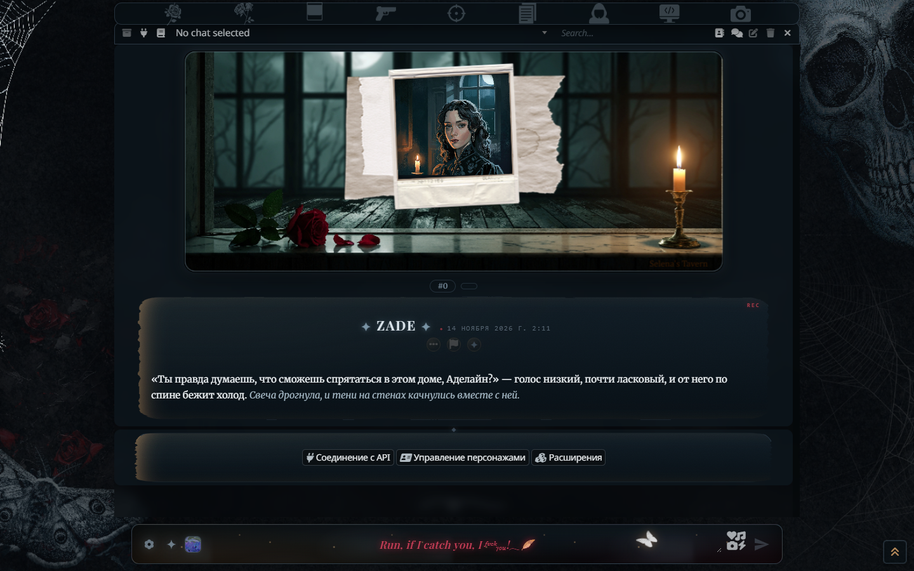
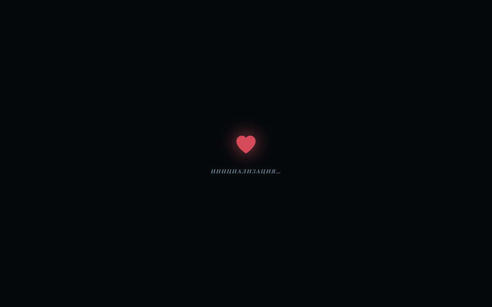

# Run, little mouse...

**Готическая тема для SillyTavern** — тёмный роман в интерфейсе: ночной склеп, свеча на подоконнике, тёмно-красная роза, полароид на стене и блокнот писательницы, за которой кто-то наблюдает.

> **Сделано с любовью ✦ Selena's Tavern ✦**
> [satsvi97.github.io/selena](https://satsvi97.github.io/selena/)



---

## Что внутри

**Палитра и шрифты**
- холодная сине-серая ночь `#0A1319 → #04070A`
- акценты: свеча `#D9A46A`, роза `#A3202F`
- Playfair Display (заголовки) + Merriweather (текст)

**Аватар-полароид**
Сцена с окном, свечой и розой; фото персонажа лежит в «окне» рамки под бумагой — фото поворачивается и обрезается вместе с полароидом. Нужен портрет, а не широкий арт.

**Панель ввода**
Тёплый свет свечи слева, холодный туман, поднимающиеся угли и живая бабочка у правого края. В пустом поле — красная строка *«Run, if I catch you…»*.

**Сердцебиение вместо «отправить»**
Пока персонаж печатает, самолётик сменяется пульсирующим сердцем — и возвращается, когда ответ готов.

**Две разные плашки**
- **он:** холодный стальной лист, арка сверху, золотая кромка слева, обтрепанный нижний край, метка `rec` в углу;
- **она:** тёмно-бордовая записка, загнутый уголок, розовая кромка справа.

У обоих — бумажное зерно, моноширинное время с красной точкой, кнопки-печати, ромб-разделитель и мягкое появление сообщения.

**Экран загрузки**
Без логотипа SillyTavern: только бьющееся сердце и надпись «Инициализация…».

**Иконки**
Свой набор PNG-иконок в топбаре вместо стандартных, тематические иконки у поля ввода.

---

## Скриншоты

| Плашки: он и она | Панель ввода |
|---|---|
|  |  |



---

## Установка

### Вариант 1 — готовый файл (быстро)

1. Скопируйте всё из папки `assets/` в `<SillyTavern>/public/nightwood/`
   (папку `nightwood` создайте, если её нет — путь важен, тема ссылается на `/nightwood/...`).
2. Импортируйте `dist/run-little-mouse.json` через панель тем SillyTavern
   (иконка темы → **Import**) или просто положите файл в
   `<SillyTavern>/data/default-user/themes/`.
3. Выберите тему **«Run, little mouse...»** в списке и обновите страницу.

### Вариант 2 — сборка из CSS

Если правите `css/run-little-mouse.css` — пересоберите JSON:

```bash
node tools/build-theme.js "C:/SillyTavern"
```

Скрипт создаст тему в `data/default-user/themes/` и пропишет её в `settings.json`,
так что хватит `Ctrl+R` без перевыбора темы.

---

## Совместимость

- SillyTavern **1.18** (проверено), нужен современный Chromium/Electron — используются `:has()`, маски и CSS-анимации.
- Часть эффектов отключается при `prefers-reduced-motion: reduce`.

## Структура

```
css/run-little-mouse.css   — исходник темы (весь CSS)
tools/build-theme.js       — сборка JSON-темы для SillyTavern
dist/run-little-mouse.json — готовая тема для импорта
assets/                    — картинки (кладём в public/nightwood)
screenshots/               — превью для README
```

## Лицензия

MIT — см. [LICENSE](LICENSE). Картинки в `assets/` — часть оформления темы, используйте их вместе с ней.

---

**Сделано с любовью ✦ Selena's Tavern ✦**
[satsvi97.github.io/selena](https://satsvi97.github.io/selena/)
