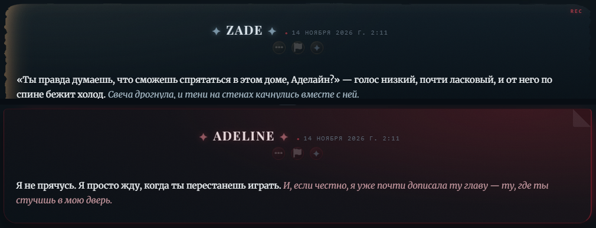
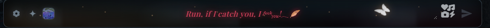

<div align="center">


<h1>Run, little mouse...</h1>

<em>«Run, if I catch you…»</em>

<br><br>


<br><br>

<b>Готическая тема для SillyTavern в духе тёмного романа.</b><br>
Свеча на подоконнике, тёмно-красная роза, полароид на стене — и кто-то, кто смотрит из темноты.

<br><br>

<a href="https://satsvi97.github.io/run-little-mouse/">
  
</a>
&nbsp;
<a href="https://github.com/satsvi97/run-little-mouse/releases/latest/download/run-little-mouse.json">
  
</a>

<br><br>

**Сделано с любовью ✦ [Selena's Tavern](https://satsvi97.github.io/selena/) ✦**

</div>

---

## Установка — один файл

**Скачайте [`run-little-mouse.json`](https://github.com/satsvi97/run-little-mouse/releases/latest/download/run-little-mouse.json)** и импортируйте его в SillyTavern.

1. Панель тем (иконка палитры) → **Import** → выберите скачанный файл.
2. Выберите тему **«Run, little mouse...»**.
3. Обновите страницу — `Ctrl+Shift+R`.

Картинки тема подгружает сама с [этой страницы](https://satsvi97.github.io/run-little-mouse/) — ничего копировать не нужно.
Работает и на телефоне: тот же один файл.

<details>
<summary>Если интернет недоступен или хочется локальные картинки</summary>

<br>

1. Скачайте [`run-little-mouse.zip`](https://github.com/satsvi97/run-little-mouse/releases/latest/download/run-little-mouse.zip).
2. Распакуйте: внутри `run-little-mouse.json` и `public/nightwood/`.
3. Скопируйте содержимое `public/nightwood/` в `<SillyTavern>/public/nightwood/`.
4. Файл темы — в `data/default-user/themes/` (или через **Import**).

Либо одной командой на Windows:

```powershell
powershell -ExecutionPolicy Bypass -File tools/install.ps1 -StPath "C:\SillyTavern"
```

</details>

---

## Что внутри

<table>
<tr>
<td width="50%" valign="top">

**Полароид**
Сцена у окна: свеча, роза и рамка полароида. Фото персонажа лежит под бумагой — поворачивается вместе с рамкой. Нужен портрет (~3:4), а не широкий арт.

**Две разные плашки**
У него — холодный стальной лист: арка, золотая кромка слева, рваный нижний край, метка `rec`. У неё — тёмно-бордовая записка с загнутым уголком и розовой кромкой.

**Сердцебиение**
Пока идёт генерация, «отправить» превращается в пульсирующее сердце — и возвращается, когда ответ готов.

</td>
<td width="50%" valign="top">

**Панель ввода**
Тёплый свет свечи слева, холодный туман, поднимающиеся угли и живая бабочка у правого края. В пустом поле — красная строка «Run, if I catch you…».

**Экран загрузки**
Без логотипа SillyTavern: только бьющееся сердце и «Инициализация…».

**Палитра**
Холодная сине-серая ночь `#0A1319 → #04070A`, свеча `#D9A46A`, роза `#A3202F`.
Playfair Display + Merriweather.

</td>
</tr>
</table>

<p align="center">
  
</p>

<p align="center">
  
</p>

---

## Совместимость

- SillyTavern **1.18** (проверено), нужен современный Chromium / Electron — используются `:has()`, CSS-маски и анимации.
- Эффекты отключаются при `prefers-reduced-motion: reduce`.

## Структура

```
css/run-little-mouse.css   — исходник темы (весь CSS)
tools/build-theme.js       — сборка JSON-темы для SillyTavern
tools/install.ps1          — установка в локальную копию ST (Windows)
dist/run-little-mouse.json — готовая тема
assets/                    — картинки (раздаются через GitHub Pages)
screenshots/               — превью
index.html                 — страница темы
```

## Сборка из исходника

```bash
node tools/build-theme.js "C:/SillyTavern"
```

Скрипт соберёт тему в `data/default-user/themes/` и пропишет её в `settings.json` —
дальше достаточно `Ctrl+R`.

## Лицензия

MIT — см. [LICENSE](LICENSE). Картинки в `assets/` — часть оформления темы.

---

<div align="center">

**Сделано с любовью ✦ [Selena's Tavern](https://satsvi97.github.io/selena/) ✦**

</div>
